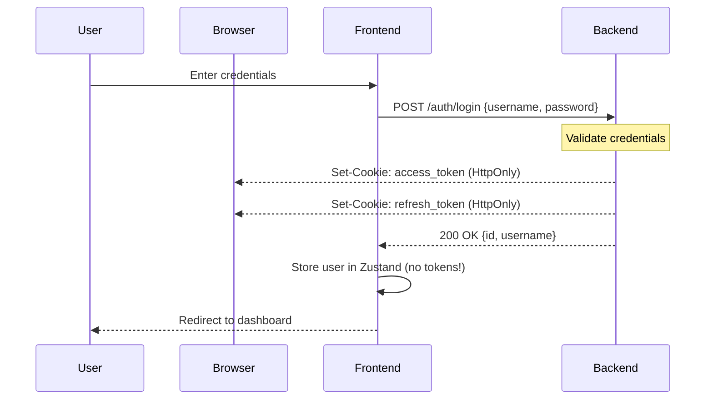
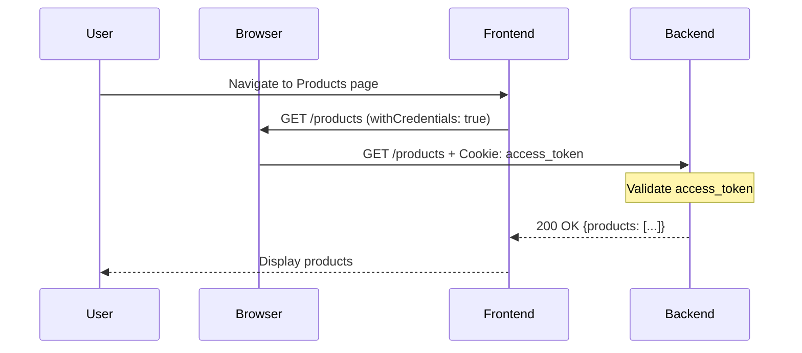
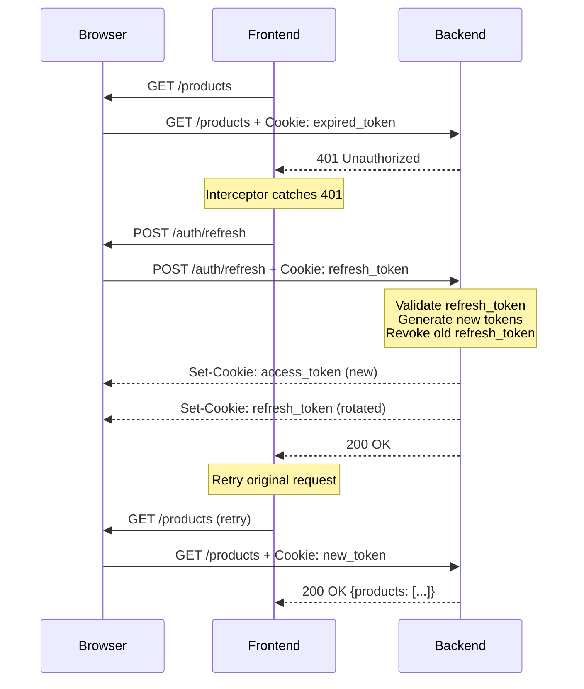
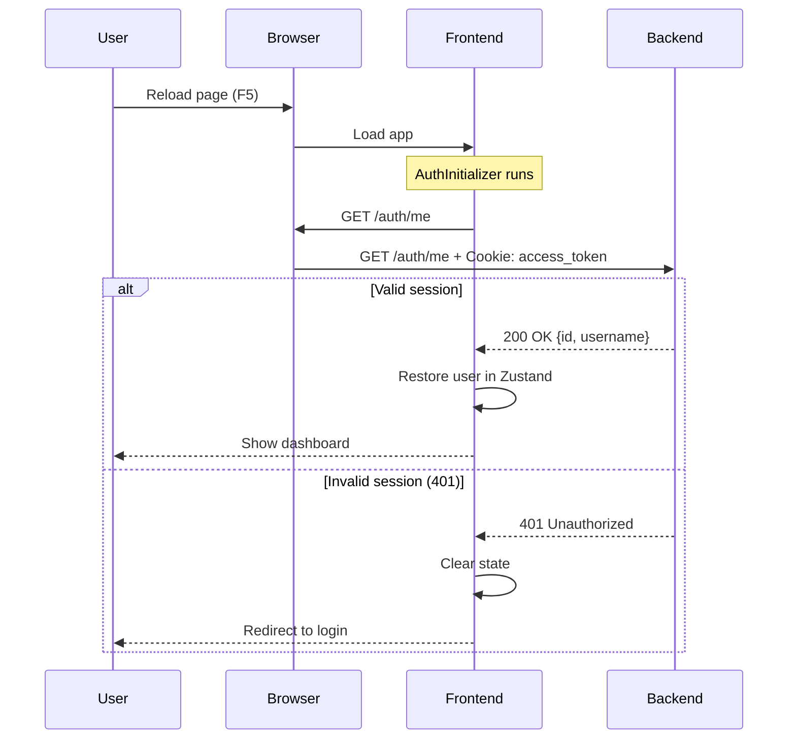
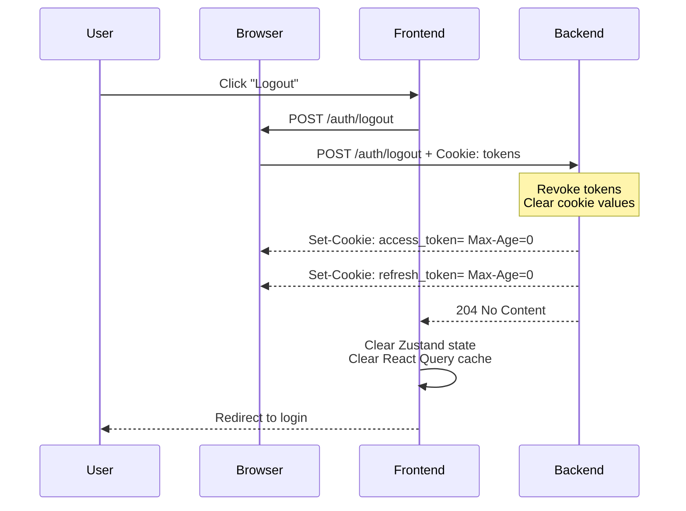
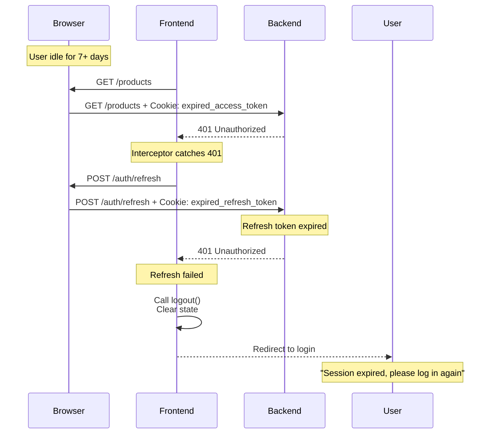

# Authentication Sequence Diagrams

This document provides visual documentation of the cookie-based authentication flows.

---

## 1. Login Flow



**Key Points:**
- Tokens never touch JavaScript - stored in httpOnly cookies
- Frontend only stores user info (id, username, role)
- Cookies sent automatically on subsequent requests

---

## 2. Authenticated Request



**Key Points:**
- Browser automatically attaches cookies (no manual header injection)
- Backend validates cookie on each request
- Frontend code never sees the tokens

---

## 3. Token Refresh (401 Interceptor)



**Key Points:**
- Refresh happens automatically (user doesn't notice)
- Refresh tokens are rotated (security best practice)
- No token manipulation in frontend code

---

## 4. Session Restoration (Page Reload)



**Key Points:**
- `/auth/me` endpoint validates session on startup
- If cookies are valid, session is restored
- If cookies expired, user is redirected to login

---

## 5. Logout Flow



**Key Points:**
- Backend clears cookies by setting `Max-Age=0`
- Frontend clears all client-side state
- React Query cache is cleared to prevent data leakage

---

## 6. Expired Refresh Token



**Key Points:**
- Both access and refresh tokens can expire
- When refresh fails, user must re-authenticate
- Graceful error handling with user-friendly message

---

## Security Architecture

### Cookie Attributes

```
Set-Cookie: access_token=<jwt>;
  Path=/;
  HttpOnly;           ← JavaScript cannot read
  Secure;             ← HTTPS only (production)
  SameSite=Lax;       ← CSRF protection
  Max-Age=1800        ← 30 minutes
```

### Token Lifetimes

| Token Type | Lifetime | Purpose |
|------------|----------|---------|
| **Access Token** | 30 minutes | API authentication |
| **Refresh Token** | 7 days | Renew access token |

### Security Benefits vs localStorage

| Aspect | localStorage (OLD) | httpOnly Cookies (NEW) |
|--------|-------------------|----------------------|
| **XSS Protection** | ❌ Vulnerable | ✅ Protected |
| **CSRF Protection** | ✅ Not applicable | ✅ SameSite=Lax |
| **Token Visibility** | ❌ JavaScript can read | ✅ JavaScript cannot access |
| **Automatic Transport** | ❌ Manual header injection | ✅ Browser handles it |
| **Code Complexity** | ❌ High (token management) | ✅ Low (just user state) |

---

## Implementation Reference

### Frontend Configuration

**Axios Setup** (`src/services/api.ts`):
```typescript
export const apiClient = axios.create({
  withCredentials: true,  // Critical for cookies!
  timeout: 10000,
});
```

**Request Interceptor**:
- Sets dynamic `baseURL`
- NO token header injection (cookies sent automatically)

**Response Interceptor**:
- Catches 401 errors
- Calls `/auth/refresh`
- Retries original request
- No token manipulation (backend updates cookies)

### Backend Endpoints

| Endpoint | Method | Request | Response |
|----------|--------|---------|----------|
| `/auth/login` | POST | `{username, password}` | `{id, username}` + Set-Cookie headers |
| `/auth/refresh` | POST | Empty (cookies in request) | Empty + Set-Cookie headers |
| `/auth/me` | GET | Empty (cookies in request) | `{id, username}` |
| `/auth/logout` | POST | Empty (cookies in request) | 204 + Clear cookies |

---

## Migration History

**Date:** February 2026
**Reason:** Eliminate XSS vulnerability from localStorage token storage
**Result:** Successfully migrated to httpOnly cookies
**Impact:** -286 lines of code, improved security, simpler architecture

**Phases Completed:**
1. ✅ Infrastructure setup
2. ✅ Service refactoring
3. ✅ State management update
4. ✅ App initialization
5. ✅ Interceptor simplification
6. ✅ Testing & verification
7. ✅ Documentation

---

## Troubleshooting

### Cookies not being sent?

1. Check `withCredentials: true` in Axios config
2. Verify CORS allows credentials on backend
3. Check cookies in DevTools under API origin (not frontend origin!)

### Session not persisting after reload?

1. Check if `AuthInitializer` is calling `/auth/me`
2. Verify cookies haven't expired
3. Check console for errors during initialization

### 401 errors not triggering refresh?

1. Verify response interceptor is configured
2. Check if URL contains `/auth/refresh` (infinite loop prevention)
3. Ensure `_retry` flag is working

---

**Last Updated:** February 2026
**Status:** Production Ready ✅
