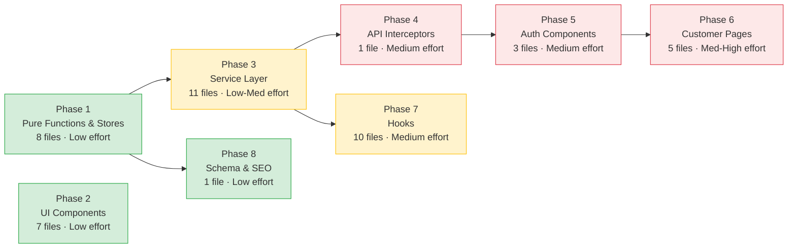

# Testing Implementation Plan

**Date:** 2026-02-14
**Updated:** 2026-02-17
**Supersedes:** `docs/UI_TESTING_ROADMAP.md` (high-level wishlist; this plan is actionable)

## Current State

| Metric | Value |
|--------|-------|
| Test files | 30 |
| Total tests | 502 |
| Testable source files | ~110 |
| Estimated coverage | ~15% |
| Infrastructure | Vitest + Testing Library + MSW (ready to go) |

### Existing Tests

| File | Coverage |
|------|----------|
| `src/components/layout/__tests__/Footer.test.tsx` | Footer rendering, admin link |
| `src/pages/__tests__/WelcomePage.test.tsx` | Comprehensive (485 lines) |
| `src/pages/customer/__tests__/ProductPage.test.tsx` | Comprehensive (530 lines) |
| `src/pages/customer/__tests__/ShoppingFlow.test.tsx` | Smoke test only (25 lines) |
| `src/lib/__tests__/queryKeys.test.ts` | Query key structure & invalidation (Phase 1) |
| `src/utils/__tests__/dateFormatters.test.ts` | Romanian date formatting (Phase 1) |
| `src/utils/__tests__/validation.test.ts` | Zod schemas & validation helpers (Phase 1) |
| `src/utils/__tests__/businessInfo.test.ts` | Business info getters & fallbacks (Phase 1) |
| `src/stores/__tests__/cartStore.test.ts` | Cart actions & computed values (Phase 1) |
| `src/stores/__tests__/authStore.test.ts` | Auth state & migration logic (Phase 1) |
| `src/services/__tests__/api.helpers.test.ts` | API error handling, URL builders, form helpers (Phase 1) |
| `src/utils/__tests__/orderFormatter.test.ts` | Order text formatting — both data paths (Phase 1) |
| `src/components/ui/__tests__/Button.test.tsx` | Variants, sizes, loading, disabled, icon, click (Phase 2) |
| `src/components/ui/__tests__/Input.test.tsx` | Label linkage, error/helper text, icons (Phase 2) |
| `src/components/ui/__tests__/Modal.test.tsx` | Open/close, Escape key, backdrop, scroll lock (Phase 2) |
| `src/components/ui/__tests__/Select.test.tsx` | Keyboard nav, portal, disabled options, ARIA (Phase 2) |
| `src/components/ui/__tests__/Toast.test.tsx` | Auto-dismiss, provider, close button, types (Phase 2) |
| `src/components/ui/__tests__/ToggleSwitch.test.tsx` | Toggle, disabled, aria-checked, sizes (Phase 2) |
| `src/components/ui/__tests__/TabNavigation.test.tsx` | Tab labels, onTabChange callbacks (Phase 2) |
| `src/services/__tests__/authService.test.ts` | Login, refresh, logout, logoutAll, isAuthenticated (Phase 3) |
| `src/services/__tests__/orders.test.ts` | CRUD, filters, pagination, sorting, order items (Phase 3) |
| `src/services/__tests__/products.test.ts` | CRUD, FormData, images, reorder (Phase 3) |
| `src/services/__tests__/lists.test.ts` | CRUD, published/expired logic, products, delivery types, positions (Phase 3) |
| `src/services/__tests__/categories.test.ts` | CRUD, image upload, reorder (Phase 3) |
| `src/services/__tests__/units.test.ts` | CRUD with params (Phase 3) |
| `src/services/__tests__/deliveryTypes.test.ts` | CRUD, reorder (Phase 3) |
| `src/services/__tests__/deliverySchedules.test.ts` | CRUD (Phase 3) |
| `src/services/__tests__/paymentMethods.test.ts` | CRUD (Phase 3) |
| `src/services/__tests__/businessDetails.test.ts` | Get, create, update, delete (Phase 3) |
| `src/services/__tests__/sessionService.test.ts` | Sessions list, current, revoke (Phase 3) |

### Infrastructure (already configured)

- **Runner:** Vitest with jsdom (`vitest.config.ts`)
- **Rendering:** `renderWithProviders` wraps QueryClient + Router (`src/test/testUtils.tsx`)
- **API mocking:** MSW with test data factories (`src/test/mocks/handlers.ts`)
- **Setup:** localStorage mock, matchMedia polyfill (`src/test/setup.ts`)
- **Libraries:** `@testing-library/react`, `@testing-library/user-event`, `@testing-library/jest-dom`

### File Clarification

This plan references two similarly named files — they serve different purposes:

| File | Contents | Tested In |
|------|----------|-----------|
| `src/utils/validation.ts` (95 lines) | Zod form schemas (phone, email, product, order, list, etc.) + `formatValidationErrors`, `validateFormData` | Phase 1.1 |
| `src/utils/schema.ts` (150 lines) | Schema.org structured data generators (`generateProductSchema`, `generateOrganizationSchema`, `injectSchemaMarkup`) | Phase 8 |

---

## Phase 1: Pure Functions & Stores (no rendering, fast) — COMPLETE

**Status:** Done (2026-02-17) — 8 test files, 289 new tests, all passing.
**Goal:** Cover all logic that has zero React dependencies — validation schemas, formatters, utilities, and Zustand stores.
**Why first:** These are the fastest to write, run instantly, and catch the most subtle bugs (date edge cases, validation boundaries, cart math).

### 1.1 Validation Schemas

**File to create:** `src/utils/__tests__/validation.test.ts`
**Source:** `src/utils/validation.ts` (95 lines)

**Test cases:**

```
phoneSchema
  ✓ accepts valid Romanian number "+40712345678"
  ✓ accepts number without prefix "0712345678"
  ✓ accepts short international "+1234567"
  ✓ rejects too-short number "12345"
  ✓ rejects letters "abc123"
  ✓ rejects empty string

emailSchema
  ✓ accepts valid email
  ✓ rejects missing @ symbol
  ✓ rejects missing domain

passwordSchema
  ✓ accepts 8+ character password
  ✓ rejects 7-character password

productSchema
  ✓ validates complete product data
  ✓ rejects missing name
  ✓ rejects negative price
  ✓ rejects missing category_id
  ✓ rejects missing unitati_id

orderSchema
  ✓ validates complete order data
  ✓ rejects missing customer name
  ✓ rejects missing list id
  ✓ rejects missing delivery type
  ✓ rejects missing payment method
  ✓ accepts optional empty phone
  ✓ validates phone when provided

listSchema
  ✓ validates complete list data
  ✓ rejects missing date
  ✓ rejects mesaj_introducere over 45 chars
  ✓ rejects alte_detalii over 500 chars

deliveryTypeSchema
  ✓ validates complete delivery type
  ✓ rejects empty denumire
  ✓ rejects denumire over 100 chars
  ✓ rejects order_index below 1 or above 127

formatValidationErrors
  ✓ formats single field error
  ✓ formats multiple field errors
  ✓ formats nested field paths

validateFormData
  ✓ returns success with valid data
  ✓ returns errors with invalid data
```

### 1.2 Date Formatters

**File to create:** `src/utils/__tests__/dateFormatters.test.ts`
**Source:** `src/utils/dateFormatters.ts` (69 lines)

**Test cases:**

```
formatDateRomanian
  ✓ formats "2026-02-14" → "14 februarie 2026"
  ✓ formats "2026-01-01" → "1 ianuarie 2026"
  ✓ formats "2026-12-31" → "31 decembrie 2026"
  ✓ formats ISO date string
  ✓ returns original string for invalid date
  ✓ handles empty string gracefully

formatDateShortRomanian
  ✓ formats "2026-02-14" → "14.02.2026"
  ✓ zero-pads single-digit day and month
  ✓ returns original string for invalid date
```

### 1.3 Order Formatter

**File to create:** `src/utils/__tests__/orderFormatter.test.ts`
**Source:** `src/utils/orderFormatter.ts` (174 lines)

**Test cases:**

```
formatOrderText (OrderConfirmationData)
  ✓ includes customer name (prenume + nume)
  ✓ lists items with quantity, name, and line total
  ✓ shows separator by default
  ✓ omits separator when includeSeparator=false
  ✓ shows subtotal + delivery tax when tax > 0
  ✓ shows only total when tax = 0
  ✓ includes payment method
  ✓ includes delivery type name
  ✓ includes delivery address when type requires it
  ✓ includes phone number when provided
  ✓ includes observatii when provided
  ✓ includes formatted list date
  ✓ appends footer text

formatOrderText (OrderRead)
  ✓ uses nume_client for customer name
  ✓ resolves product names via getProductName callback
  ✓ falls back to "Produs #id" without callback
  ✓ calculates delivery tax from config
  ✓ resolves payment method name via callback
```

### 1.4 API Helpers (pure functions only)

**File to create:** `src/services/__tests__/api.helpers.test.ts`
**Source:** `src/services/api.ts` — `handleApiError`, `createFormData`, `createQueryParams`, image URL helpers

**Test cases:**

```
handleApiError
  ✓ returns network error message for ERR_NETWORK
  ✓ returns timeout message for ECONNABORTED
  ✓ returns server error message for 500+
  ✓ returns conflict message for 409
  ✓ returns validation message for 422
  ✓ returns not found message for 404
  ✓ returns image validation message for 400 with image_ type
  ✓ returns generic message for other 4xx
  ✓ returns generic message for non-Axios errors

createFormData
  ✓ appends string values
  ✓ appends File instances
  ✓ JSON-stringifies objects
  ✓ skips null and undefined values

createQueryParams
  ✓ builds query string from params
  ✓ skips null and undefined values
  ✓ returns empty string for empty params

getImageUrl
  ✓ returns null for null/undefined input
  ✓ returns full URL unchanged
  ✓ prepends API base for paths starting with /
  ✓ constructs /api/v1/static/ path for filenames

getProductImageUrl
  ✓ uses product.image_versions when available
  ✓ falls back to product.images[0].image_versions
  ✓ returns placeholder when no images
  ✓ handles version parameter (original, medium, thumbnail)

getCategoryImageUrl
  ✓ uses category.image_versions when available
  ✓ returns placeholder without image_versions

getLogoUrl
  ✓ returns default for null/undefined
  ✓ returns full URL unchanged
  ✓ returns paths starting with / unchanged
  ✓ prepends / to relative paths
```

### 1.5 Cart Store

**File to create:** `src/stores/__tests__/cartStore.test.ts`
**Source:** `src/stores/cartStore.ts` (92 lines)

**Approach:** Test directly via `useCartStore.getState()` and `useCartStore.setState()` — no rendering needed.

**Test cases:**

```
addItem
  ✓ adds new item with quantity 1
  ✓ increments quantity for existing item
  ✓ does not duplicate items with same id

removeItem
  ✓ removes item by id
  ✓ leaves other items untouched
  ✓ no-op for non-existent id

updateQuantity
  ✓ updates quantity for item
  ✓ removes item when quantity set to 0
  ✓ clamps to 0 (no negative quantities)

purgeItemsNotInList
  ✓ keeps items matching listId
  ✓ removes items from other lists

clearCart
  ✓ removes all items

getTotalItems
  ✓ sums all quantities
  ✓ returns 0 for empty cart

getTotalPrice
  ✓ sums pret * quantity for all items
  ✓ returns 0 for empty cart
  ✓ handles decimal prices correctly
```

### 1.6 Auth Store

**File to create:** `src/stores/__tests__/authStore.test.ts`
**Source:** `src/stores/authStore.ts` (98 lines)

**Test cases:**

```
login
  ✓ sets user and isAuthenticated=true
  ✓ sets isLoading=false

logout
  ✓ clears user and sets isAuthenticated=false
  ✓ sets isLoading=false

setLoading
  ✓ updates isLoading flag

updateUser
  ✓ updates user without changing isAuthenticated

migrateAuthStorage
  ✓ clears old token keys from localStorage
  ✓ forces isAuthenticated=false in migrated data
  ✓ preserves user data during migration
  ✓ sets migration flag
  ✓ no-ops if already migrated
  ✓ handles corrupt JSON gracefully
```

### 1.7 Business Info Helpers

**File to create:** `src/utils/__tests__/businessInfo.test.ts`
**Source:** `src/utils/businessInfo.ts` (164 lines)

**Test cases:**

```
getBusinessName
  ✓ returns business_name from API data
  ✓ falls back to app name from config
  ✓ handles undefined input

getBusinessAddress
  ✓ returns adresa from API data
  ✓ returns fallback for missing data

getBusinessPhone
  ✓ returns telefon from API data
  ✓ returns fallback for missing data

getBusinessEmail
  ✓ returns email from API data
  ✓ returns fallback for missing data

getBusinessCUI
  ✓ returns CUI from API data
  ✓ returns fallback for missing data

getBusinessRegistrationNumber
  ✓ returns numar_inregistrare from API data
  ✓ returns fallback for missing data

getBusinessRepresentative
  ✓ returns reprezentant from API data
  ✓ returns fallback for missing data
```

### 1.8 Query Keys

**File to create:** `src/lib/__tests__/queryKeys.test.ts`
**Source:** `src/lib/queryKeys.ts` (137 lines)

**Approach:** Pure functions — verify key structure ensures correct cache invalidation.

**Test cases:**

```
queryKeys structure
  ✓ categories.all returns ['categories']
  ✓ categories.list(filters) includes filters in key
  ✓ categories.detail(id) includes id in key
  ✓ products keys follow same pattern
  ✓ orders keys follow same pattern
  ✓ lists keys follow same pattern
  ✓ child keys are prefixed by parent (invalidation correctness)
  ✓ different filters produce different keys
  ✓ same filters produce identical keys
```

---

## Phase 2: Reusable UI Components — COMPLETE

**Status:** Done (2026-02-17) — 7 test files, 66 new tests, all passing.
**Goal:** Cover the shared component library — ensures they work correctly in isolation.
**Why early:** Zero dependencies on other phases, easy wins that build testing momentum and catch accessibility issues.

### 2.1 Components to Test

| File to Create | Source | Key Test Cases |
|---------------|--------|----------------|
| `src/components/ui/__tests__/Button.test.tsx` | `ui/Button.tsx` | Variants, sizes, loading, disabled, click handler, icon placement |
| `src/components/ui/__tests__/Input.test.tsx` | `ui/Input.tsx` | Label, error state, helper text, icons, aria attributes |
| `src/components/ui/__tests__/Modal.test.tsx` | `ui/Modal.tsx` | Open/close, escape key, backdrop click, body scroll lock |
| `src/components/ui/__tests__/Select.test.tsx` | `ui/Select.tsx` | Options, selection, placeholder, disabled, error |
| `src/components/ui/__tests__/Toast.test.tsx` | `ui/Toast.tsx` + `ToastContainer.tsx` | Show/dismiss, types (success/error/warning), auto-dismiss timer |
| `src/components/ui/__tests__/ToggleSwitch.test.tsx` | `ui/ToggleSwitch.tsx` | Toggle on/off, disabled, label |
| `src/components/ui/__tests__/TabNavigation.test.tsx` | `ui/TabNavigation.tsx` | Tab switching, active state |

---

## Phase 3: Service Layer — COMPLETE

**Status:** Done (2026-02-17) — 11 test files, 116 new tests, all passing.
**Goal:** Test every service function's API call correctness — right HTTP method, right URL, right payload, right return value.
**Approach:** Use MSW to intercept requests and verify behavior. This tests real HTTP interactions rather than mocking `apiClient` internals, producing tests that are more resilient to refactors. The MSW infrastructure is already set up — extend `src/test/mocks/handlers.ts` incrementally as each service is tested.

### 3.1 Auth Service

**File to create:** `src/services/__tests__/authService.test.ts`
**Source:** `src/services/authService.ts` (117 lines)

**Test cases:**

```
login
  ✓ calls POST /auth/login with credentials
  ✓ updates auth store with user data on success
  ✓ maps "username" to "email" and "name"
  ✓ throws on network error
  ✓ throws on 401 (wrong credentials)

refreshAccessToken
  ✓ calls POST /auth/refresh
  ✓ does not call logout on failure (interceptor handles it)
  ✓ throws on failure

changePassword
  ✓ calls POST /auth/change-password with correct body

logout
  ✓ calls POST /auth/logout
  ✓ clears auth store even if backend call fails
  ✓ clears React Query cache

logoutOthers
  ✓ calls POST /auth/logout-others
  ✓ returns message from response

logoutAll
  ✓ calls POST /auth/logout-all
  ✓ clears auth store even if backend call fails
  ✓ clears React Query cache

isAuthenticated
  ✓ returns auth store's isAuthenticated value
```

### 3.2 Order Service

**File to create:** `src/services/__tests__/orders.test.ts`
**Source:** `src/services/orders.ts` (129 lines)

**Test cases:**

```
createOrder
  ✓ calls POST /orders with order data
  ✓ appends source query param when provided
  ✓ returns created order

getOrder
  ✓ calls GET /orders/:id

listOrders
  ✓ calls GET /orders with no params when no filters
  ✓ appends all filter params correctly
  ✓ handles pagination (skip, limit)
  ✓ handles sorting (sort_by, sort_order)

updateOrder
  ✓ calls PATCH /orders/:id with partial data

deleteOrder
  ✓ calls DELETE /orders/:id
  ✓ appends ?permanent=true when requested

restoreOrder
  ✓ calls POST /orders/:id/restore

addOrderItem
  ✓ calls POST /orders/:orderId/products

updateOrderItem
  ✓ calls PATCH /orders/:orderId/products/:productId

removeOrderItem
  ✓ calls DELETE /orders/:orderId/products/:productId
```

### 3.3 Product Service

**File to create:** `src/services/__tests__/products.test.ts`
**Source:** `src/services/products.ts` (157 lines)

**Test cases:**

```
getProducts
  ✓ calls GET /products with no params
  ✓ appends search, category_id, limit, skip filters
  ✓ appends include_deleted when true

getProduct
  ✓ calls GET /products/:id

createProduct
  ✓ sends FormData with required fields
  ✓ includes optional fields when present
  ✓ sets Content-Type to undefined (for FormData)

updateProduct
  ✓ sends FormData with only provided fields
  ✓ handles partial updates

deleteProduct
  ✓ calls DELETE /products/:id

uploadProductImage
  ✓ sends FormData with file
  ✓ calls POST /products/:id/images

deleteProductImage
  ✓ calls DELETE /products/:productId/images/:imageId

setPrimaryImage
  ✓ calls PUT /products/:productId/images/:imageId/primary

reorderProductImages
  ✓ calls PUT /products/:productId/images/reorder with mappings
```

### 3.4 List Service

**File to create:** `src/services/__tests__/lists.test.ts`
**Source:** `src/services/lists.ts` (215 lines)

**Test cases:**

```
getPublishedList
  ✓ returns the published, non-deleted list
  ✓ returns null when list is expired
  ✓ returns null when no published list exists
  ✓ returns null on API error

getLastExpiredPublishedList
  ✓ returns most recently expired published list
  ✓ returns null when no expired lists
  ✓ ignores deleted lists
  ✓ ignores lists without expiration_date

getLists / getList
  ✓ appends filter params correctly
  ✓ calls correct URL

createList / updateList / replaceList / deleteList / cloneList
  ✓ calls correct HTTP method and URL

List-product operations
  ✓ addProductToList sends stock when provided
  ✓ addProductsToList sends array of IDs
  ✓ removeProductFromList calls DELETE
  ✓ replaceListProducts calls PUT
  ✓ updateListProductStock sends PATCH with stock

List-delivery type operations
  ✓ addDeliveryTypeToList calls POST
  ✓ removeDeliveryTypeFromList calls DELETE
  ✓ replaceListDeliveryTypes calls PUT

bulkUpdatePositions
  ✓ calls PUT with positions payload
```

### 3.5 Remaining Services (lighter coverage)

Create one test file per service, covering the happy path for each function:

| File to Create | Source | Methods |
|---------------|--------|---------|
| `src/services/__tests__/categories.test.ts` | `categories.ts` | CRUD + image upload |
| `src/services/__tests__/units.test.ts` | `units.ts` | CRUD |
| `src/services/__tests__/deliveryTypes.test.ts` | `deliveryTypes.ts` | CRUD |
| `src/services/__tests__/deliverySchedules.test.ts` | `deliverySchedules.ts` | CRUD |
| `src/services/__tests__/paymentMethods.test.ts` | `paymentMethods.ts` | CRUD |
| `src/services/__tests__/businessDetails.test.ts` | `businessDetails.ts` | Get + Update |
| `src/services/__tests__/sessionService.test.ts` | `sessionService.ts` | List + Revoke |

---

## Phase 4: API Interceptors

**Goal:** Test the axios interceptor logic — the most critical runtime code in the app.
**Approach:** Use MSW `server.use()` to simulate 401 responses, then verify refresh/retry/redirect behavior.

### 4.1 Request Interceptor

**File to create:** `src/services/__tests__/api.interceptors.test.ts`

**Test cases:**

```
Request interceptor
  ✓ sets dynamic baseURL from runtime config
  ✓ upgrades http→https when page is served over HTTPS
  ✓ falls back to localhost:8001 when config is missing

Response interceptor — HTML detection
  ✓ rejects response with HTML content-type
  ✓ passes through JSON responses normally

Response interceptor — 401 refresh flow
  ✓ refreshes token on 401 and retries original request
  ✓ only one refresh request when multiple 401s fire concurrently
  ✓ redirects to /login when refresh fails
  ✓ clears auth store when refresh fails
  ✓ clears React Query cache when refresh fails

Response interceptor — auth endpoint 401
  ✓ does NOT retry /auth/refresh on 401 (prevents infinite loop)
  ✓ does NOT retry /auth/logout on 401
  ✓ redirects to /login immediately

Response interceptor — non-401 errors
  ✓ passes through 400, 403, 404, 500 errors unchanged
```

---

## Phase 5: Auth Components

**Goal:** Test the authentication UI — login page, session initialization, and route protection.
**Approach:** Component tests with `renderWithProviders` + MSW.

### 5.1 AuthInitializer

**File to create:** `src/components/__tests__/AuthInitializer.test.tsx`
**Source:** `src/components/AuthInitializer.tsx` (68 lines)

**Test cases:**

```
When user appears authenticated
  ✓ shows loading spinner during initialization
  ✓ calls GET /auth/me to validate session
  ✓ renders children after successful validation
  ✓ updates user data from /auth/me response
  ✓ logs out and renders children when /auth/me fails (401)

When user is not authenticated
  ✓ skips /auth/me call
  ✓ renders children immediately (after init)
```

### 5.2 ProtectedRoute

**File to create:** `src/components/__tests__/ProtectedRoute.test.tsx`
**Source:** `src/components/ProtectedRoute.tsx` (43 lines)

**Test cases:**

```
  ✓ renders children when authenticated
  ✓ redirects to /login when not authenticated
  ✓ preserves location state (return URL) in redirect
  ✓ shows loading spinner when isLoading=true
```

### 5.3 LoginPage

**File to create:** `src/pages/__tests__/LoginPage.test.tsx`
**Source:** `src/pages/LoginPage.tsx`

**Test cases:**

```
  ✓ renders login form with username and password fields
  ✓ shows validation errors for empty fields
  ✓ calls auth service login on submit
  ✓ shows error message on failed login (401)
  ✓ redirects to admin dashboard on successful login
  ✓ redirects to original location if state.from is set
  ✓ toggles password visibility
```

---

## Phase 6: Customer-Facing Pages

**Goal:** Test the remaining customer pages — the revenue-critical checkout flow.

### 6.1 CartPage

**File to create:** `src/pages/customer/__tests__/CartPage.test.tsx`
**Source:** `src/pages/customer/CartPage.tsx`

**Test cases:**

```
  ✓ displays cart items with names, prices, quantities
  ✓ shows empty cart state with link to products
  ✓ updates quantity via +/- buttons
  ✓ removes item from cart
  ✓ calculates and displays correct total
  ✓ navigates to order form on checkout
```

### 6.2 OrderForm

**File to create:** `src/pages/customer/__tests__/OrderForm.test.tsx`
**Source:** `src/pages/customer/OrderForm.tsx`

**Test cases:**

```
  ✓ displays cart items summary
  ✓ validates required fields (name, delivery type, payment method)
  ✓ shows delivery address field when delivery type requires it
  ✓ validates phone number format
  ✓ calculates total with delivery tax
  ✓ submits order via API
  ✓ navigates to confirmation on success
  ✓ shows error on failed submission
  ✓ redirects to home when cart is empty
```

### 6.3 OrderConfirmation

**File to create:** `src/pages/customer/__tests__/OrderConfirmation.test.tsx`
**Source:** `src/pages/customer/OrderConfirmation.tsx`

**Test cases:**

```
  ✓ displays order details (items, totals, delivery)
  ✓ copy-to-clipboard button works
  ✓ WhatsApp link contains formatted order text
  ✓ back-to-products navigation works
  ✓ redirects home when no order data
```

### 6.4 CatalogPage & CategoryCatalogPage

**File to create:** `src/pages/customer/__tests__/CatalogPage.test.tsx`

**Test cases:**

```
  ✓ renders product categories and products
  ✓ add-to-cart updates cart store
  ✓ quantity controls work
  ✓ out-of-stock products show badge
  ✓ navigate to product page on click
  ✓ shows loading state
  ✓ shows error state
```

### 6.5 Shopping Flow (end-to-end integration)

**File to expand:** `src/pages/customer/__tests__/ShoppingFlow.test.tsx` (currently 24 lines — smoke test only)

**Goal:** Test the full customer journey across pages, distinct from the individual page tests above.

**Test cases:**

```
Complete shopping flow
  ✓ browse catalog → add items to cart → cart shows correct items
  ✓ cart → checkout form → fills required fields → submits order
  ✓ order submission → confirmation page shows order details
  ✓ confirmation → WhatsApp link contains correct order text
  ✓ confirmation → back to products returns to catalog

Edge cases
  ✓ adding same product twice increments quantity
  ✓ removing all items from cart redirects to empty cart state
  ✓ checkout with empty cart redirects to home
  ✓ order form preserves data on validation error
```

---

## Phase 7: Hooks (React Query wrappers)

**Goal:** Verify hooks wire up React Query correctly — cache keys, data transforms, error handling.
**Approach:** Use `renderHook` with QueryClient + MSW.

### 7.1 High-Priority Hooks

| File to Create | Source | Key Test Cases |
|---------------|--------|----------------|
| `src/hooks/__tests__/useProducts.test.ts` | `useProducts.ts` | Fetches products, caches results, handles filters, error state |
| `src/hooks/__tests__/useOrders.test.ts` | `useOrders.ts` | Fetches orders, mutations (create/update/delete), cache invalidation |
| `src/hooks/__tests__/useLists.test.ts` | `useLists.ts` | Published list fetching, expiration logic |
| `src/hooks/__tests__/useErrorHandler.test.ts` | `useErrorHandler.ts` | Error classification, toast triggering, friendly vs. scary errors |

### 7.2 Lower-Priority Hooks

| File to Create | Source |
|---------------|--------|
| `src/hooks/__tests__/useCategories.test.ts` | `useCategories.ts` |
| `src/hooks/__tests__/useDeliveryTypes.test.ts` | `useDeliveryTypes.ts` |
| `src/hooks/__tests__/usePaymentMethods.test.ts` | `usePaymentMethods.ts` |
| `src/hooks/__tests__/useUnits.test.ts` | `useUnits.ts` |
| `src/hooks/__tests__/useSessions.test.ts` | `useSessions.ts` |
| `src/hooks/__tests__/useBusinessDetails.test.ts` | `useBusinessDetails.ts` |

---

## Phase 8: Schema & SEO Utilities

**File to create:** `src/utils/__tests__/schema.test.ts`
**Source:** `src/utils/schema.ts` (150 lines) — Schema.org structured data generators (NOT Zod validation — see Phase 1.1)

**Test cases:**

```
generateProductSchema
  ✓ returns valid Schema.org Product structure
  ✓ includes price, currency, category
  ✓ falls back to generated description when missing

generateOrganizationSchema
  ✓ includes name, URL, social links
  ✓ includes logo when provided
  ✓ includes contact point when phone provided

injectSchemaMarkup
  ✓ adds script[type=application/ld+json] to document head
  ✓ replaces existing script with same id
  ✓ handles invalid schema gracefully

removeSchemaMarkup
  ✓ removes script by data-schema-id
  ✓ removes generic ld+json script when no id
```

---

## MSW Handler Extensions

The existing `src/test/mocks/handlers.ts` covers public endpoints. The following handlers need to be added for Phases 3-6:

```typescript
// Auth endpoints
http.post(`${API}/auth/login`, ...)
http.post(`${API}/auth/refresh`, ...)
http.post(`${API}/auth/logout`, ...)
http.get(`${API}/auth/me`, ...)
http.post(`${API}/auth/change-password`, ...)

// Order endpoints
http.post(`${API}/orders`, ...)
http.get(`${API}/orders`, ...)
http.get(`${API}/orders/:id`, ...)
http.patch(`${API}/orders/:id`, ...)
http.delete(`${API}/orders/:id`, ...)

// Admin CRUD (for service tests)
http.post(`${API}/products`, ...)
http.patch(`${API}/products/:id`, ...)
http.delete(`${API}/products/:id`, ...)
```

These can be added incrementally — each phase adds the handlers it needs.

---

## Test Utility Extensions

Add to `src/test/testUtils.tsx`:

```typescript
// Reset auth store between tests
export const resetAuthStore = () => {
  useAuthStore.setState({
    user: null,
    isAuthenticated: false,
    isLoading: false,
  });
};

// Set authenticated state for protected route tests
export const setAuthenticated = (user?: Partial<User>) => {
  useAuthStore.setState({
    user: {
      id: 1,
      email: 'admin@test.ro',
      name: 'admin',
      role: 'admin',
      ...user,
    },
    isAuthenticated: true,
    isLoading: false,
  });
};
```

---

## Execution Order & Estimates

| Phase | New Test Files | Depends On | Effort |
|-------|---------------|------------|--------|
| **1. Pure functions & stores** | 8 | Nothing | Low — no rendering, no mocking complexity |
| **2. UI components** | 7 | Nothing (independent) | Low — isolated components |
| **3. Service layer** | 11 | Phase 1 (store tests inform mocking) | Low-Medium — MSW-based, verify HTTP calls |
| **4. API interceptors** | 1 | Phase 3 (auth service) | Medium — MSW-based, async flows |
| **5. Auth components** | 3 | Phase 4 (interceptors) | Medium — component rendering + MSW |
| **6. Customer pages** | 4 (+1 expanded) | Phase 5 (auth) + existing MSW handlers | Medium-High — full page rendering |
| **7. Hooks** | 10 | Phase 3 (services) | Medium — renderHook + MSW |
| **8. Schema/SEO** | 1 | Nothing | Low — pure functions + DOM |

**Total new test files:** ~46
**Combined with existing:** 50 test files

### Dependency Diagram



**Legend:** Green = no dependencies (can start immediately), Yellow = depends on Phase 1 or 3, Red = depends on the critical path.

Phases 1, 2, and 8 have no dependencies and can be done in parallel. After Phase 1, Phases 3 and 8 can run in parallel. Phase 4 depends on 3, Phase 5 on 4, Phase 6 on 5. Phase 7 can start after Phase 3.

---

## Coverage Targets

| After Phase | Estimated Coverage | Test Files |
|-------------|-------------------|------------|
| Phase 1 | ~8% | 12 |
| Phase 2 | ~15% | 19 |
| Phase 3 | ~25% | 30 |
| Phase 4 | ~28% | 31 |
| Phase 5 | ~33% | 34 |
| Phase 6 | ~45% | 39 |
| Phase 7 | ~55% | 49 |
| Phase 8 | ~57% | 50 |

**Note:** These are conservative estimates based on ~25k total source lines with admin pages (~10k lines) excluded from the denominator. Actual coverage depends on branch complexity and how thoroughly each test exercises code paths.

---

## What This Plan Does NOT Cover

- **Admin pages** (35+ files) — deferred until core coverage is solid. These are lower risk because they're behind auth and used by a single user.
- **E2E tests** (Playwright/Cypress) — a separate initiative. The unit/integration tests here complement, not replace, E2E.
- **PDF generation** (`OrdersPDF.tsx`, `ProductsTotalsPDF.tsx`) — `@react-pdf/renderer` is hard to test in jsdom. Skip for now.
- **Push notification hooks** — depend on Service Worker APIs not available in jsdom.
- **PWA install prompt** — depends on `beforeinstallprompt` event, hard to simulate.

---

## CI Integration (post-implementation)

Once test coverage reaches Phase 4+, add to the CI pipeline:

```yaml
# In CI workflow
- name: Run tests
  run: npx vitest run --reporter=verbose

- name: Check coverage
  run: npx vitest run --coverage
  # Fail if coverage drops below threshold
```

Add to `vitest.config.ts`:

```typescript
test: {
  coverage: {
    provider: 'v8',
    reporter: ['text', 'lcov'],
    thresholds: {
      statements: 40,
      branches: 30,
      functions: 40,
      lines: 40,
    },
  },
}
```

**Note:** Start with lower thresholds (above) and ratchet up as coverage improves. Target thresholds after all phases:

```typescript
thresholds: {
  statements: 55,
  branches: 45,
  functions: 55,
  lines: 55,
},
```
